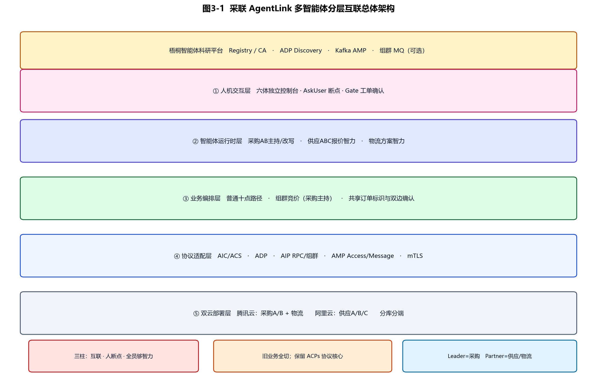
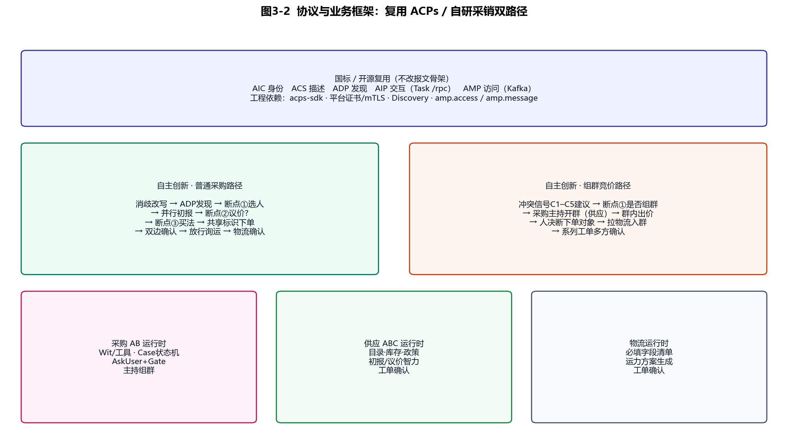
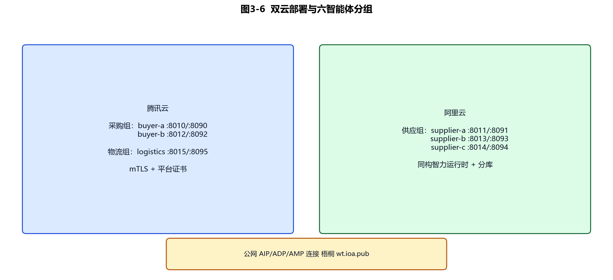
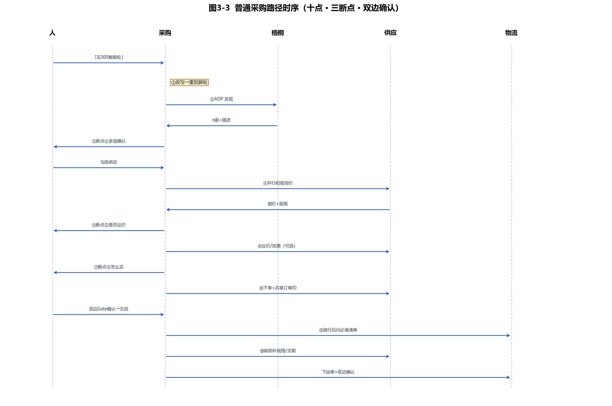
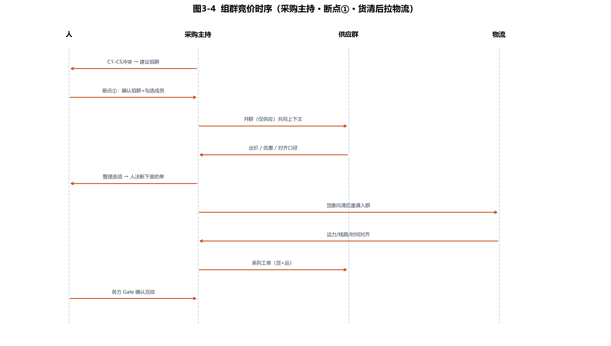
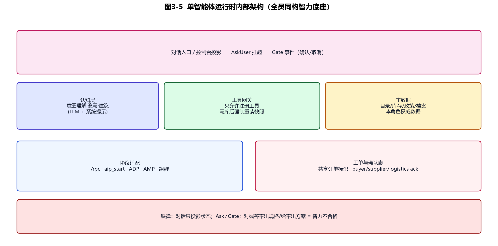

# 三、智能体互联技术选型与方案设计

> 本文依据《采销网络双路径互联》产品根设计撰写，面向「人在智能体中」的六体采销网络。  
> **工程边界**：保留 ACPs/AIP 协议与梧桐接入；旧采销业务实现全部切割，在协议之上按本文从零搭建。  
> **插图目录**：`docs/design_report_ch3/figures/`（图3-1～图3-6）。  
> **说明**：当前插图为可提交级程序化工程图；若环境已配置 `CUSTOM_IG_API_KEY`，可用 `custom-imagegen` 按同主题重渲。

---

## 1. 基础开发资源选型

### 1.1 协议与平台资源

本作品互联能力建立在**国家 AIP 智能体互联标准对应的开源实现与梧桐平台通道**之上，而不是自造私有协议。

| 资源 | 选型 | 用途 |
|------|------|------|
| 开源协议栈 | 开放原子 AIP-PUB / ACPs（`acps-sdk`） | AIC/ACS/ADP/AIP/AMP 报文与客户端能力 |
| 科研平台 | 梧桐智能体科研平台（`wt.ioa.pub`） | Registry/CA 注册发证、Discovery 发现、访问统计 |
| 发现 | ADP `POST …/acps-adp-v2/discover` | 按能力/描述检索可协作智能体 |
| 交互 | AIP Task + Partner `/rpc`；组群通道（平台 MQ） | 点对点询价议价下单；组群共同上下文 |
| 访问 | Kafka `amp.access` / `amp.message` | 双侧访问记账，后台可统计 |
| 安全 | 平台证书 + mTLS | 跨云身份与传输保护 |

**合规原则**：国标/平台报文**结构不改**；业务字段放入 structured 扩展位；组群失败可标注回退，但不伪造「平台命中」。

### 1.2 运行时与业务资源

| 层次 | 选型 | 理由 |
|------|------|------|
| 服务框架 | Python ≥3.12 + FastAPI | 与 ACPs 生态一致；快速暴露 `/rpc` 与本域 API |
| 认知编排 | Wit 类 Agents 运行时 + DeepSeek（OpenAI 兼容） | 理解、改写、工具规划；**不直接改国标字段** |
| 主数据 | SQLite **分库**（每智能体一库）+ 采购案文件隔离 | 演示级 ERP；禁止跨域直连库 |
| 前端 | 六体独立控制台（静态页 + 本域代理） | 角色清晰；断点 UI 与工单 Gate 分离 |
| 异构验证 | 供应侧可保留 Java Partner 样例 | 证明同一 AIP 面上实现语言可异构 |
| 部署 | 双云 systemd；腾讯采购/物流，阿里供应 | 贴近真实跨企业拓扑 |

**模型定位**：模型是「认知与工具选择」组件；短名单确认、下单确认、是否组群等**效力动作**必须经人断点或 Gate，禁止模型嘴上确认代替写库。

### 1.3 开发与接入环境说明

- **教程与样例**：以 AIP-PUB / ACPs 官方样例与梧桐接入文档为基线，完成注册→发证→发现→RPC→AMP 最小闭环后再叠业务。  
- **软硬件**：双云 Linux 主机；本机 Windows 用于控制台与取证；证书由平台 CA 签发。  
- **国标对齐方式**：身份（AIC）、描述（ACS）、发现（ADP）、交互（AIP）、访问（AMP）五类能力一一映射工程模块；业务只增「采销双路径 + HITL」，不改 Task 骨架。

---

## 2. 核心技术方案设计

### 2.1 总体架构（分层互联）

系统采用**五层多智能体分层互联架构**（见图3-1）：

1. **人机交互层**：六体控制台；AskUser 选题断点；Gate 工单确认。  
2. **智能体运行时层**：采购 AB / 供应 ABC / 物流 — **全员同构智力底座**（能对话、能工具、能对主数据负责）。  
3. **业务编排层**：普通采购十点路径；组群竞价（采购主持）；共享订单标识与多方确认。  
4. **协议适配层**：AIC/ACS/ADP/AIP/AMP、mTLS、组群适配；**本层保留 ACPs 核心**。  
5. **双云部署层**：腾讯云采购+物流；阿里云三供应；分库分端。

横向贯穿：梧桐 Registry/CA/Discovery/Kafka。



**三根支柱（产品硬约束）**

| 柱 | 含义 |
|----|------|
| 多智能体互联 | 发现走平台，询价/议价/下单/询运走对端或组群 |
| 人在断点 | 选对象/是否议价/怎么买/是否组群/确认效力/放行物流 |
| 全员够智力 | 供应答得出规格与政策；物流给得出运力方案 |

### 2.2 协议与业务框架（复用 / 创新）

见图3-2。上半为**开源复用**（ACPs 五能力）；下半为**自主创新**两条业务路径与三类运行时。



| 类别 | 内容 | 是否改国标结构 |
|------|------|----------------|
| 复用 | AipRpcClient、Task 模型、Discovery/Kafka、证书链路 | 否 |
| 适配 | payload 封装、mTLS、发现缓存、live AIC 绑定 | 否（工程封装） |
| 创新 | 十点普通路径、组群主持竞价、Ask/Gate 分离、共享订单确认、全员智力运行时 | 否（业务层） |
| 禁止 | 伪造 platform_adp、静默吞组群失败、对话否认真相状态 | — |

### 2.3 关键技术选型细项

#### （1）注册与发现

- 六体各自持有 ACS，平台审核后获 AIC；证书 CN 与 AIC 对齐。  
- 采购以**改写后的完整需求**调用 ADP（例：「采购300套重型脚轮」），平台返回 n 家及描述。  
- 发现结果**必须经人断点①**圈定交互对象或确认是否组群，禁止自动全员询价/自动开群。

#### （2）跨智能体数据传输

- **点对点**：AIP `start` 结构化任务 → Partner `/rpc` 回执（初报、议价、下单、询运字段、运力方案）。  
- **组群**：采购主持维护共同上下文；供应入群出价；货意向清后拉物流。  
- **业务扩展字段**放入 structured dataItem；保留 `business_id` / 共享订单标识贯通确认态。

#### （3）协同调度

- **硬编排**：Case/Ticket 状态机决定合法迁移。  
- **软入口**：LLM 只触发已注册工具；AskUser 为挂起式工具调用；Gate 为 UI 事件写库。  
- **普通路径**：并行初报 → 可选议价 → 人定买法 → 双边确认 → 询运。  
- **组群路径**：冲突信号建议 → 人断点① → 主持开群 → 人决断 → 拉物流 → 系列确认。

#### （4）安全交互与认证

- 默认平台证书 + mTLS；HTTP AIP 与组群 AMQP 身份绑定可分平面配置。  
- 工单确认态以库为准；模型不得用自然语言覆盖 ack 字段。

### 2.4 部署视图

见图3-6。

| 云 | 智能体 | API / UI（示意） |
|----|--------|------------------|
| 腾讯云 | buyer-a, buyer-b, logistics | 8010/8090，8012/8092，8015/8095 |
| 阿里云 | supplier-a/b/c | 8011/8091，8013/8093，8014/8094 |



---

## 3. 业务双路径详细设计

### 3.1 普通采购路径（十点时序）

见图3-3。核心：**三断点 + 两确认闸 + 询运放行**。



| 步 | 动作 | 互联对象 | 人机 |
|----|------|----------|------|
| 1 | 理解消歧 + query 改写（对照采购画像/库） | 本地 | — |
| 2 | ADP 发现 | 梧桐 | — |
| 3 | 带描述多选列表 | — | **断点①** |
| 4 | 并行初报「请报价」 | 入选供应 | — |
| 5 | 是否探优惠 | — | **断点②** |
| 6 | 议价话术（可选） | 供应 | — |
| 7 | 怎么买（含满减建议/Other） | — | **断点③** |
| 8 | 下单 + 共享订单标识 | 供应 | **Gate 双边确认** |
| 9 | 人放行后问物流必填清单 | 物流 | **放行** |
| 10 | 缺字段问供应 → 下运单 | 供应/物流 | **Gate 双边确认** |

### 3.2 组群竞价路径

见图3-4。**主持=采购智能体**；开群前必须断点①；物流在**人决断下单对象之后**入群。



**冲突建议信号（C1–C5，满足任一可建议，不可自动开群）**

| 信号 | 含义 |
|------|------|
| C1 口径冲突 | ≥2 家关键属性不一致 |
| C2 可比性不足 | 无法做同一张比价表 |
| C3 需求复合 | 多物料线且无单家覆盖 |
| C4 政策不可比 | 优惠门槛口径互斥 |
| C5 人显式要求 | 用户要求竞价/拉群 |

### 3.3 AskUser 与 Gate 分离

| 机制 | 用途 | 例子 |
|------|------|------|
| AskUser | 挂起任务，选路径/偏好 | 是否议价、怎么买、是否组群 |
| Gate | 写确认态，产生效力 | 工单确认、短名单确认交互 |

铁律：对话只投影状态；写库后强制重读快照；禁止「已确认」话术与 `ack=false` 并存。

---

## 4. 六智能体技术实现设计

全员共用**同构智力运行时底座**（见图3-5），差异在画像、主数据与工具集。



### 4.1 共性运行时架构

```text
控制台/对话
    → 认知层（LLM：理解·改写·建议·组群主持话术）
    → 工具网关（白名单工具；写库后 reload snapshot）
    → 主数据（本角色权威）
    → 协议适配（/rpc、ADP、AIP、AMP、组群）
    → 工单与共享订单标识确认态
```

**智力验收（可测）**

| 角色 | 必过项 |
|------|--------|
| 采购 | 改写正确；组织发现；断点不越权；缺物流字段知道问谁 |
| 供应 | 初报含规格价；议价能给政策理由；被问规格/交期能答；能确认工单 |
| 物流 | 能声明必填清单；收齐后能出运力方案（价/时效/线路）；能确认工单 |

### 4.2 采购商 A（buyer-a）· 保定高端座椅

| 项 | 设计 |
|----|------|
| 角色 | Leader；普通路径编排者；**组群主持** |
| 画像改写 | 「脚轮」→ 默认重型/高档物料倾向 |
| 核心模块 | 需求消歧、ADP 客户端、并行 RFQ、议价组织、买法建议、Case 状态机、AskUser、工单 Gate、物流字段对账、组群主持 |
| 数据 | `buyer-a.sqlite3`；独立采购案文件 |
| 端口 | API 8010 · UI 8090 |
| 与 B 差异 | 仅策略/默认 SKU；**交互契约相同** |

**关键工具（最小集）**：`rewrite_demand` · `adp_discover` · `offer_shortlist` · `rfq_parallel` · `ask_user` · `bargain` · `decide_purchase` · `place_order` · `read_ticket` · `query_logistics_schema` · `fill_and_place_logistics` · `host_group_auction`

### 4.3 采购商 B（buyer-b）· 承德平价办公

与 A **同构运行时与十点/组群契约**；画像偏向标准脚轮/经济物料；独立 AIC/库/UI（8012/8092）。用于证明「同契约多租户采购智能体」可并存。

### 4.4 供应商 A（supplier-a）· 沧州组件 · price-first

| 项 | 设计 |
|----|------|
| 角色 | Partner；响应询价/议价/下单/规格追问 |
| 智力 | 目录计价 + 政策解释（如脚轮满 500 九折）；交期/规格可答 |
| 模块 | `/rpc` 收件、报价图/策略、议价回复、订单工单 ack、组群内出价 |
| 数据 | 本厂 catalog/库存；`supplier-a.sqlite3` |
| 端口 | 8011 / 8091 |

### 4.5 供应商 B（supplier-b）· 邢台软装 · custom-MOQ

同构 Partner 运行时；强调定制字段与 MOQ；议价需解释门槛；面料/海绵主数据。端口 8013/8093。

### 4.6 供应商 C（supplier-c）· 太原 · 紧缺/替代

同构 Partner；可返回替代 SKU、分批说明；组群中需能解释冲突口径。端口 8014/8094。

### 4.7 物流（logistics）· 采联智运

| 项 | 设计 |
|----|------|
| 角色 | Partner；**不**在开群瞬间入群 |
| 智力 | 暴露运单必填清单；生成运力方案（价/时效/线路）；工单确认 |
| 普通路径 | 人放行后被问清单 → 收齐字段 → 下单 → 双边确认 |
| 组群路径 | 人决断货对象后由采购主持邀请入群 → 谈细节 → 系列运单 |
| 端口 | 8015 / 8095 |

**必填清单（默认）**：货物规格摘要、计费量、起运地、到达地、期望出库/发货时间。清单外字段不阻塞下单。

---

## 5. 开源复用与自主创新边界（撰写要点）

### 5.1 原生复用模块

- ACPs/AIP SDK 与 Task/Access 模型  
- 梧桐注册、发现、证书、Kafka AMP 通道  
- （可选）Wit 对话框架能力  

### 5.2 独立创新模块

- 采销**普通十点**与**组群主持竞价**双路径  
- AskUser / Gate 分离的人在环模型  
- 冲突信号 C1–C5 与断点①开群门禁  
- 共享订单标识 + 多方确认态  
- 全员同构智力运行时与角色主数据  
- 物流「清单为主、追问为辅」与入群时机策略  
- 双云分库控制台与取证  

### 5.3 二次开发表述建议（对应大纲）

> 本作品在 AIP/ACPs 开源互联栈与梧桐平台通道上开展深度二次开发：不改国标报文骨架，自主完成采销场景的人在环双路径编排、采购主持组群竞价、全员可验收智力运行时及跨云部署，使「能发现、能调用、能统计」的协议能力落地为可演示、可确认的工业采购协同。

---

## 6. 方案对需求的覆盖

| 需求 | 方案落点 |
|------|----------|
| 注册→发现→互联→访问 | AIC/ACS + ADP + AIP/组群 + AMP |
| 人在智能体中 | 断点①②③ + Gate + 组群决断 |
| 普通/组群双路线 | §3.1 / §3.2 |
| 对端够智力 | §4 验收表 |
| 跨云 | 图3-6 |
| 旧实现切割 | 业务重搭；协议层保留 |

---

## 7. 附图清单

| 图号 | 文件 | 内容 |
|------|------|------|
| 图3-1 | `figures/fig3-1_architecture.png` | 分层总体架构 |
| 图3-2 | `figures/fig3-2_framework.png` | 协议复用 / 业务创新框架 |
| 图3-3 | `figures/fig3-3_seq_normal.png` | 普通采购十点时序 |
| 图3-4 | `figures/fig3-4_seq_group.png` | 组群竞价时序 |
| 图3-5 | `figures/fig3-5_agent_runtime.png` | 单智能体运行时 |
| 图3-6 | `figures/fig3-6_deploy.png` | 双云部署 |

---

## 8. 后续工程落地顺序（建议）

1. 协议层冒烟：六体注册/发现/RPC/AMP 保活（保留 ACPs）。  
2. 采购 AB：普通十点 + Ask/Gate（先打通双边确认）。  
3. 供应 ABC：初报/议价/规格问答智力。  
4. 物流：清单 + 方案 + 确认。  
5. 组群：主持 + 断点① + 货清后拉物流。  

（正文完）
